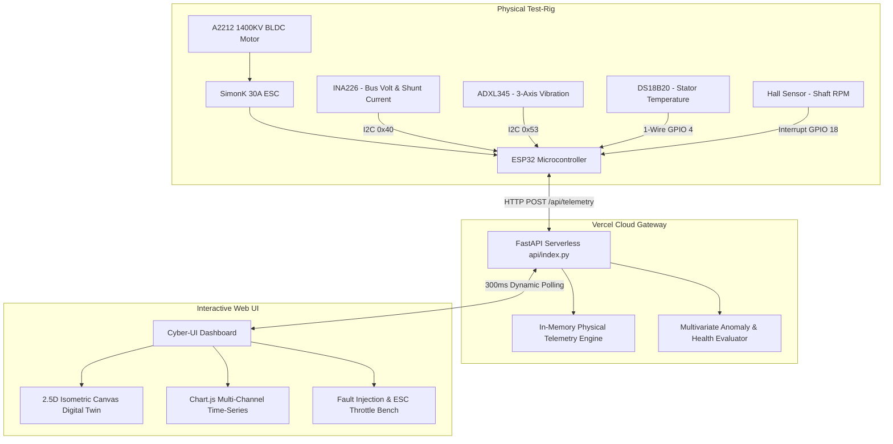
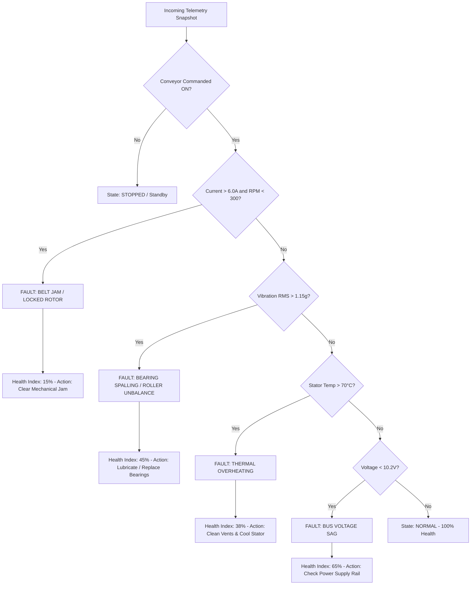

# BLDC Conveyor Belt Health Monitoring & AI Predictive Maintenance

This skill provides comprehensive architectural procedures, operational runbooks, sensor calibration guidelines, fault isolation algorithms, and deployment workflows for the BLDC Motor-Driven Conveyor Belt Condition Monitoring system.

---

## 1. System Architecture & Component Mapping



---

## 2. Sensor Instrumentation & Telemetry Protocols

| Parameter | Sensor / Pinout | Telemetry Key | Nominal Range | Warning Threshold | Critical Fault Threshold |
| :--- | :--- | :--- | :--- | :--- | :--- |
| **Supply Voltage** | INA226 (I²C `0x40`) | `voltage` | $11.8\text{V} - 12.6\text{V}$ | $<10.8\text{V}$ | $<9.8\text{V}$ (Voltage Sag / Rail Drop) |
| **Phase Current** | INA226 Shunt | `current` | $1.8\text{A} - 3.8\text{A}$ | $>5.5\text{A}$ | $>10.0\text{A}$ (Belt Jam / Locked Rotor) |
| **Motor Speed** | Hall Interrupt (GPIO 18) | `rpm` | $2500 - 4500\text{ RPM}$ | $<1500\text{ RPM}$ | $0\text{ RPM}$ while commanded ON (Stall) |
| **Linear Velocity** | Derived: $(\frac{\text{RPM}}{60}) \pi D$ | `belt_speed_m_s` | $1.2 - 2.5\text{ m/s}$ | $<0.6\text{ m/s}$ | $0.0\text{ m/s}$ |
| **Stator Temp** | DS18B20 (1-Wire GPIO 4) | `temperature` | $25.0 - 45.0\text{°C}$ | $>58.0\text{°C}$ | $>72.0\text{°C}$ (Insulation Breakdown Hazard) |
| **Vibration RMS** | ADXL345 (I²C `0x53`) | `vibration_rms` | $<0.28\text{g}$ (Zone A) | $0.71 - 1.15\text{g}$ (Zone C) | $>1.15\text{g}$ (Zone D - Immediate Trip) |

---

## 3. Diagnostic & Fault Deduction Decision Tree



---

## 4. Operational Runbook

### Running the Local Development Server
```powershell
# 1. Navigate to workspace
cd e:\bldc-conveyor-monitoring

# 2. Verify requirements
pip install -r requirements.txt

# 3. Launch the dashboard runner
python run.py
```
Access dashboard at: `http://localhost:8000`

### Deploying to Vercel
```powershell
# Deploy via Vercel CLI
cd e:\bldc-conveyor-monitoring
vercel
```

### Flashing Physical ESP32 Hardware
1. Open [`firmware/esp32_conveyor.ino`](./firmware/esp32_conveyor.ino) in Arduino IDE or PlatformIO.
2. Install required libraries: `INA226_WE`, `Adafruit ADXL345`, `DallasTemperature`, `ESP32Servo`.
3. Configure `WIFI_SSID`, `WIFI_PASS`, and set `SERVER_URL` to your Vercel deployment endpoint (`https://<project>.vercel.app/api/telemetry`).
4. Flash ESP32 over USB-C / UART at 115200 baud.
