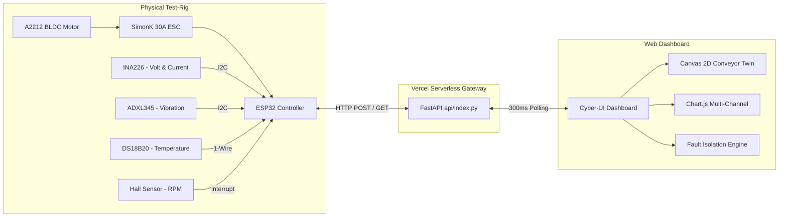

# BLDC Conveyor Belt Health Monitoring & AI Predictive Maintenance Platform

A condition telemetry and predictive maintenance platform engineered for **BLDC Motor-Driven Conveyor Belt Systems**.

Features real-time sensor ingestion, a high-FPS Canvas 2D Digital Twin with moving cargo packages, master ON/OFF controls, and multivariate AI fault deduction hosted on **Vercel Serverless**.

---

## 1. System Architecture



---

## 2. Monitored Parameters & Sensor Mapping

| Parameter | Sensor / Source | Unit | Telemetry Field | Monitored Failure Condition |
| :--- | :--- | :--- | :--- | :--- |
| **Voltage** | INA226 (I²C `0x40`) | $\text{V}$ | `voltage` | Power supply voltage sag ($<10.2\text{V}$) under conveyor load. |
| **Current** | INA226 Shunt | $\text{A}$ | `current` | Belt jam / locked rotor overcurrent ($>12\text{A}$), phase imbalance. |
| **Speed (RPM)** | Hall Effect Interrupt | $\text{RPM}$ | `rpm` | Stall conditions, belt slippage, speed drop during heavy loading. |
| **Belt Speed** | Calculated ($(\text{RPM}/60) \times \pi D$) | $\text{m/s}$ | `belt_speed_m_s` | Linear speed of the conveyor belt (with 80mm head drum). |
| **Temperature** | DS18B20 (1-Wire) | $\text{°C}$ | `temperature` | Stator coil overheating ($>60\text{°C}$ Warning, $>72\text{°C}$ Critical). |
| **Vibration** | ADXL345 (I²C `0x53`) | $\text{g RMS}$ | `vibration_rms` | Roller imbalance, bearing wear, ISO 10816 Zone D ($>1.15\text{g}$). |

---

## 3. Conveyor Belt Fault Detection Rules

1. **Belt Jam / Motor Stall**:
   - Condition: Motor is commanded ON, but $\text{RPM} < 300$ and Current $> 6.0\text{A}$.
   - Response: Health Index plunges to $15\%$, State turns `CRITICAL`, spark particles & warning icon appear on the canvas twin.
2. **Bearing Degradation / Looseness**:
   - Condition: Vibration RMS $> 0.71\text{g}$ (ISO 10816-3 Zone C/D).
   - Response: Health Index drops, canvas twin vibrates with physical shake displacement.
3. **Motor Thermal Runaway**:
   - Condition: Stator temperature exceeds $65\text{°C}$.
   - Response: Radiant pulsing red heat aura expands around the motor body on the canvas twin.
4. **Supply Voltage Sag**:
   - Condition: Voltage drops below $10.2\text{V}$ while current surges.
   - Response: Alerts operator to high power-line impedance or battery depletion.

---

## 4. Local Execution Guide

1. Install Python requirements:
   ```powershell
   pip install -r requirements.txt
   ```
2. Launch the local development server:
   ```powershell
   python run.py
   ```
3. The dashboard will automatically launch at `http://localhost:8000`.

---

## 5. Deployment to Vercel

This repository is pre-configured with `vercel.json` for zero-configuration serverless hosting:

### Method A: Via Vercel CLI (Fastest)
1. Install Vercel CLI:
   ```powershell
   npm install -g vercel
   ```
2. In the `bldc-conveyor-monitoring` directory, run:
   ```powershell
   vercel
   ```
3. Follow the CLI prompts to deploy.

### Method B: Via GitHub & Vercel Dashboard
1. Push this folder to a new GitHub repository.
2. Log into [vercel.com](https://vercel.com) and click **"Add New Project"**.
3. Select your GitHub repository and click **Deploy**.
4. Vercel automatically detects `api/index.py` and `public/` and deploys your live URL!
